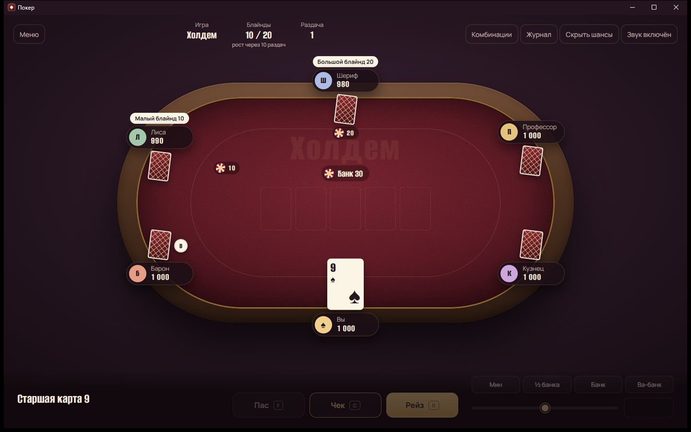

# Покер

Покер против ботов для Windows. Безлимитный стол до шести игроков, три режима, без регистрации и без интернета.



## Скачать

Готовый `Poker-win-x64.exe` лежит в [релизах](https://github.com/eidogh-code/Poker/releases). Это один файл: скачайте и запустите, установка не нужна.

Для работы нужен Microsoft Edge WebView2 Runtime — в Windows 10 и 11 он обычно уже есть. Если его нет, игра сама предложит страницу загрузки.

## Режимы

- **Холдем** — две карты на руках и пять на столе, лучшая пятёрка из семи. Безлимитные ставки.
- **Омаха** — четыре карты на руках, в комбинации ровно две из них и три со стола. Ставки до размера банка.
- **Холдем с джокерами** — в колоде два джокера, они заменяют любую карту. Старшая комбинация — покер, пять одинаковых.

Соперники играют по-разному: Барон давит ставками, Лиса блефует, Шериф ждёт сильных карт, Профессор держит баланс, Кузнец коллирует почти всё. Решения ботов опираются на расчёт шансов, а не на случай.

## Управление

| Клавиша | Действие |
| --- | --- |
| `F` | Пас |
| `C` | Чек или колл |
| `R` | Ставка или рейз выбранного размера |
| `↑` / `↓` | Изменить размер ставки на большой блайнд |
| `Пробел` | Следующая раздача |
| `F11` | Полный экран |
| `Esc` | Закрыть панель или диалог, выйти из полного экрана |

Справка по комбинациям — кнопка «Комбинации» над столом.

## Сборка из исходников

Нужен [.NET 8 SDK](https://dotnet.microsoft.com/download/dotnet/8.0) и Node.js 18+ для тестов.

```powershell
node --test                                          # тесты движка
powershell -ExecutionPolicy Bypass -File build.ps1   # dist\Покер.exe
```

Игру можно запустить и без сборки: откройте `poker/index.html` в браузере.

Каждый пуш в `main` собирается в GitHub Actions — exe лежит в артефактах запуска. Чтобы выпустить релиз, поставьте тег:

```powershell
git tag v1.0.1
git push origin v1.0.1
```

## Устройство

```
poker/        игра: HTML, CSS, JS, шрифты — общая для браузера и приложения
  js/cards.js   колода, оценка комбинаций, расчёт шансов
  js/game.js    раздача, торговля, побочные банки, вскрытие
  js/ai.js      решения ботов
  js/ui.js      стол, панель действий, меню
app/          оболочка Windows на .NET 8 + WebView2; игра встраивается в exe
tests/        тесты движка (node --test)
build.ps1     сборка dist\Покер.exe
```

Настройки и положение окна хранятся в `%LOCALAPPDATA%\PokerNight`.

Шрифты Alumni Sans и Manrope распространяются по лицензии SIL Open Font License 1.1.
