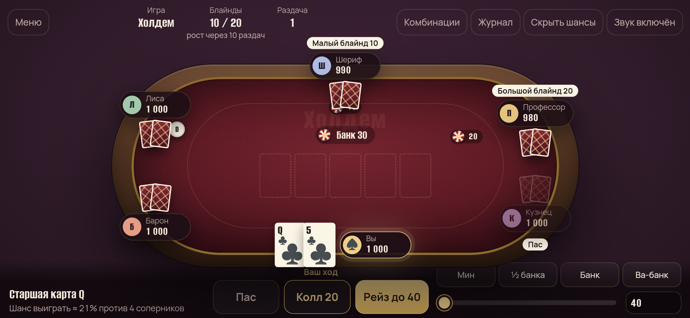

# Покер

Покер против ботов для Windows и Android. Кэш-стол до шести игроков, четыре режима, свой баланс, без регистрации и без интернета.


## Скачать

Готовые файлы лежат в [релизах](https://github.com/eidogh-code/Poker/releases).

**Windows** — `Poker-win-x64.exe`. Один файл: скачайте и запустите, установка не нужна. Нужен Microsoft Edge WebView2 Runtime — в Windows 10 и 11 он обычно уже есть; если нет, игра сама предложит страницу загрузки.

**Android** — `Poker-android.apk`, Android 7.0 и новее. Откройте файл на телефоне и разрешите установку из этого источника, когда система спросит. Игра идёт в альбомной ориентации на весь экран; кнопка «Назад» закрывает панели, а за столом спрашивает, выйти ли из игры.



## Режимы

- **Холдем** — две карты на руках и пять на столе, лучшая пятёрка из семи. Безлимитные ставки.
- **Омаха** — четыре карты на руках, в комбинации ровно две из них и три со стола. Ставки до размера банка.
- **Холдем с джокерами** — в колоде два джокера, они заменяют любую карту. Старшая комбинация — покер, пять одинаковых.
- **Шорт-дек** — колода с шестёрок (36 карт). Флеш старше фулл-хауса, тройка старше стрита, младший стрит — A-6-7-8-9.

Соперники играют по-разному: Барон давит ставками, Лиса блефует, Шериф ждёт сильных карт, Профессор держит баланс, Кузнец коллирует почти всё. Решения ботов опираются на расчёт шансов, а не на случай. Разорившийся бот уходит, а на его место садится новый — всего их дюжина.

Что ещё в планах — Rush & Cash и турниры — описано в [docs/ROADMAP.md](docs/ROADMAP.md).

## Баланс и стол

- **Баланс.** На старте 10 000 фишек. Садясь за стол, вы вносите выбранную сумму из баланса, уходя — забираете остаток обратно. Если закрыть игру посреди партии, фишки со стола вернутся на баланс при следующем запуске.
- **Ежедневный бонус** — 10 000 раз в день.
- **Кончились фишки** — минута, чтобы пополнить стек из баланса, иначе вы выходите из-за стола.
- **Таймер хода** — 30 секунд. Не успели: если ставок нет, игра чекает за вас, если нужно коллировать — сбрасывает карты, и вы «отходите от стола». Раздачи идут без вас, место держится 3 минуты; вернувшись, вы доплачиваете большой блайнд.
- **Профиль** — ник и аватар: один из восьми или своё фото.
- **Оформление** — пять цветов сукна и пять рубашек карт.
- **Телефон** можно держать и горизонтально, и вертикально — интерфейс перестраивается под ориентацию.
- **Музыка** — неспешный лаунж-джаз, который синтезируется прямо в игре (без файлов и интернета). Включается и выключается кнопкой «Музыка».

## Игра по сети

Кнопка «Играть по сети» в меню открывает лобби.

- **Открытый стол** виден всем в списке «Открытые столы».
- **Закрытый стол** не виден в списке — к нему заходят только по коду из 6 символов. Код показывается в комнате, его можно скопировать и отправить друзьям.
- Создатель стола выбирает игру, взнос, блайнды и можно ли сажать ботов на свободные места, и нажимает «Начать игру», когда все собрались. Подсесть можно и во время игры — со следующей раздачи.
- **Чат** — в комнате ожидания и за столом (кнопка «Чат» над столом, на ней счётчик непрочитанных).
- Взнос списывается с баланса устройства, при уходе остаток возвращается. Если связь пропала, игра держит место: ходы пропускаются по таймеру, через 3 минуты отсутствия место освобождается. При переподключении вы возвращаетесь на то же место.

### Сервер

Сетевой игре нужен сервер (`server/`, Node.js + WebSocket). Он использует тот же игровой движок, что и приложение, и не хранит ничего, кроме текущих комнат в памяти.

Развернуть бесплатно на [Render](https://render.com):

1. Зарегистрируйтесь на Render и подключите GitHub.
2. Dashboard → **New** → **Blueprint** → выберите репозиторий `eidogh-code/Poker`. Render прочитает [render.yaml](render.yaml) и соберёт сервер из [Dockerfile](Dockerfile).
3. Когда сервис запустится, скопируйте его адрес, например `https://poker-server-ab12.onrender.com`.
4. В игре: «Играть по сети» → поле «Адрес сервера» → вставьте адрес (можно без `https://`) → «Подключиться». Чтобы адрес был в приложении по умолчанию, впишите `wss://…` в `poker/js/config.js` и пересоберите.

Бесплатный сервер Render засыпает после 15 минут без игроков — первое подключение после этого занимает до минуты.

Запустить сервер у себя: `cd server && npm install && npm start` (порт 8787, адрес для браузера на этом же компьютере — `ws://localhost:8787`; приложениям нужен защищённый `wss://`).

## Управление

| Клавиша | Действие |
| --- | --- |
| `F` | Пас |
| `C` | Чек или колл |
| `R` | Ставка или рейз выбранного размера |
| `↑` / `↓` | Изменить размер ставки на большой блайнд |
| `Пробел` | Следующая раздача |
| `F11` | Полный экран |
| `Esc` | Закрыть панель или диалог, выйти из полного экрана |

Справка по комбинациям — кнопка «Комбинации» над столом.

## Сборка из исходников

Нужен [.NET 8 SDK](https://dotnet.microsoft.com/download/dotnet/8.0) и Node.js 18+ для тестов.

```powershell
node --test                                          # тесты движка
powershell -ExecutionPolicy Bypass -File build.ps1   # dist\Покер.exe
```

Игру можно запустить и без сборки: откройте `poker/index.html` в браузере.

### Android

Нужны JDK 17+ и Android SDK с платформой 35 (проще всего — через Android Studio). Путь к SDK укажите в `android/local.properties` строкой `sdk.dir=…` или переменной `ANDROID_HOME`.

```powershell
cd android
.\gradlew.bat assembleRelease   # app\build\outputs\apk\release\Poker-1.0.0-release.apk
```

APK подписывается ключом из `~/.android/poker-release.properties` (поля `storeFile`, `storePassword`, `keyAlias`, `keyPassword`; путь к ключу — относительно этого файла). Ключ в репозиторий не попадает. Без него сборка подписывается отладочным ключом — такой APK ставится, но поверх него не встанет версия с настоящим ключом.

Чтобы GitHub Actions подписывал APK вашим ключом, добавьте в репозитории секреты (Settings → Secrets and variables → Actions):

- `ANDROID_KEYSTORE_BASE64` — файл ключа в base64: `[Convert]::ToBase64String([IO.File]::ReadAllBytes("$HOME\.android\poker-release.jks")) | Set-Clipboard`
- `ANDROID_KEYSTORE_PASSWORD` — пароль из `poker-release.properties`.

### Сборка в GitHub

Каждый пуш в `main` собирается в GitHub Actions — exe и apk лежат в артефактах запуска. Чтобы выпустить релиз с обоими файлами, поставьте тег:

```powershell
git tag v1.0.1
git push origin v1.0.1
```

## Устройство

```
poker/        игра: HTML, CSS, JS, шрифты — общая для браузера, Windows и Android
  js/cards.js   колода, оценка комбинаций, расчёт шансов
  js/game.js    раздача, торговля, побочные банки, вскрытие
  js/ai.js      решения ботов
  js/profile.js профиль, баланс, бонус, оформление
  js/menu.js    главное меню, окна «Профиль» и «Оформление»
  js/ui.js      стол, панель действий, таймер хода, «отошёл», пополнение
app/          оболочка Windows на .NET 8 + WebView2; игра встраивается в exe
  js/net.js     соединение с сервером, RemoteGame (снимки сервера в форме Game)
  js/lobby.js   лобби, комнаты, чат
  js/music.js   музыка, синтезируется в Web Audio
android/      оболочка Android: Activity с WebView, игра лежит в assets APK
server/       сервер сетевой игры (Node.js + ws), тесты — npm test
tests/        тесты движка (node --test)
build.ps1     сборка dist\Покер.exe
```

В Windows настройки и положение окна хранятся в `%LOCALAPPDATA%\PokerNight`, в Android — в данных приложения.

Шрифты Alumni Sans и Manrope распространяются по лицензии SIL Open Font License 1.1.
